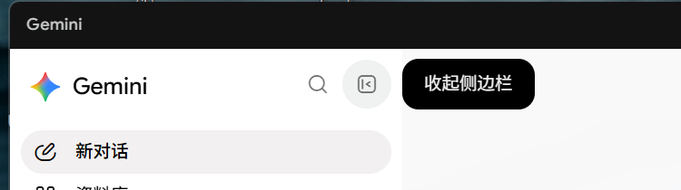
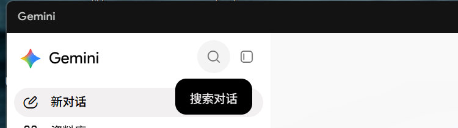
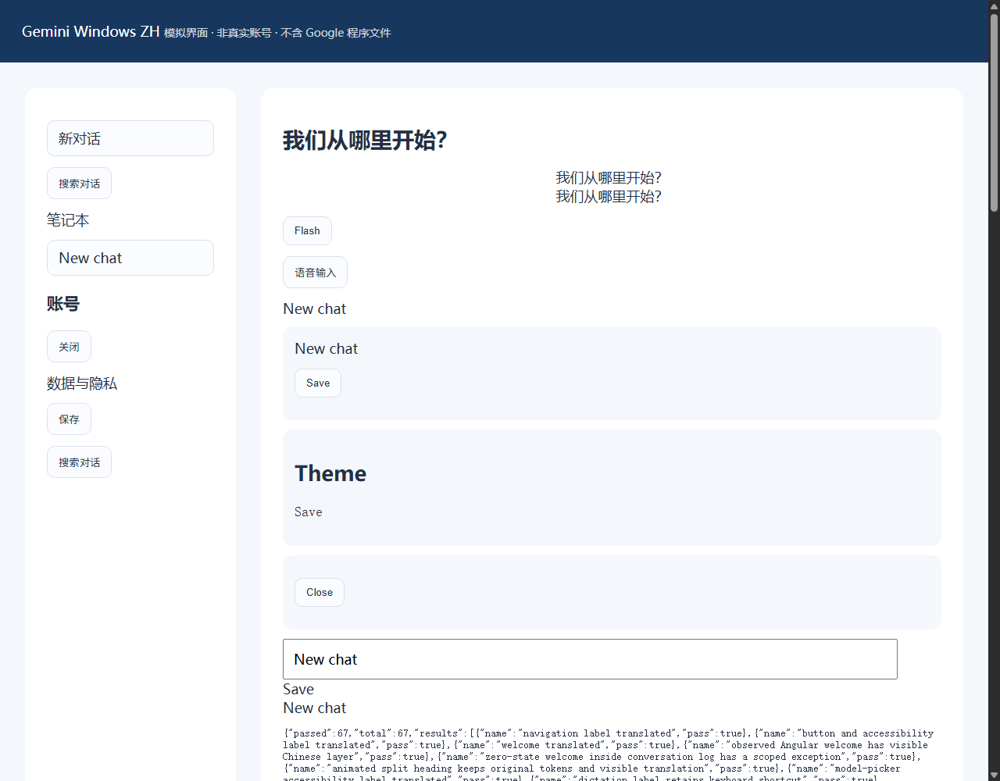

# Gemini Windows ZH

[](https://github.com/yaozhiheng227-lgtm/gemini-windows-zh/actions/workflows/check.yml)

**让受支持的 Gemini Windows 客户端显示更多简体中文界面。** 适用于“桌面菜单已有中文，内嵌网页仍有英文”的情况，覆盖已收录的导航、悬浮提示、设置菜单及部分二级设置说明。

**[下载 v0.1.3 实验版 ZIP](https://github.com/yaozhiheng227-lgtm/gemini-windows-zh/releases/download/v0.1.3/gemini-windows-zh-v0.1.3.zip)** · [版本说明与校验文件](https://github.com/yaozhiheng227-lgtm/gemini-windows-zh/releases/tag/v0.1.3) · [新手安装与常见问题](docs/GETTING_STARTED.md) · [反馈问题](https://github.com/yaozhiheng227-lgtm/gemini-windows-zh/issues/new?template=bug_report.md)

> **非官方社区补丁，与 Google 无从属或背书关系。仅支持已登记的 Gemini Windows 1.16.0 x64 构建，不是独立客户端，也不是浏览器扩展。** 仍有漏翻，不承诺全界面或其他版本汉化。补丁会修改本地资源包，提供备份和校验恢复；不会修改账号语言、套餐或地区。

## 安装前确认

| 你需要具备 | 如何确认 |
| --- | --- |
| Windows x64 | 实测 Windows 11 x64；ARM64、macOS、Linux 不在客户端适配范围 |
| 已安装的 Gemini Windows 1.16.0 | 还必须匹配已登记文件指纹；双击 `检查状态.cmd` 自动检查 |
| 已有 Node.js 20+ | 在终端运行 `node --version`；新安装建议选 [Node.js 官方下载页](https://nodejs.org/zh-cn/download) 的 24 LTS 系列，本项目已验证该主版本 |

无需 Git、API Key 或 `npm install`，当前用户安装目录一般不需要管理员权限。**版本号相同也可能不是相同构建**；未知文件指纹或启用嵌入式 ASAR 校验时会拒绝安装，不提供强制绕过方式。

## 第一次使用：下载 → 检查 → 安装

1. 下载上方 ZIP，右键选择“全部解压”。进入能看到 `安装中文.cmd` 和 `package.json` 的目录，**不要在压缩包窗口内直接运行**。
2. 双击 **`检查状态.cmd`**。成功时显示状态信息；第一次使用通常为 `compatible: true`、`patched: false`。没有安装过补丁时，备份字段为 `false` 是正常的。出现“失败”时先看 [排障说明](docs/GETTING_STARTED.md#常见问题)，不要继续安装。
3. 在 Gemini 顶部主菜单选择 **文件 → 退出**，再双击 **`安装中文.cmd`**。看到 `"action": "installed"` 表示安装完成；`already-installed` 表示已装好相同补丁。
4. 正常打开 Gemini，检查导航、搜索和侧边栏悬浮提示。可再次运行 `检查状态.cmd`：已安装时应有 `patched: true`、`backupValid: true`、`stateMatches: true`。**这些状态不代表全部页面都已汉化。**

命令行用户可在解压目录打开 PowerShell：先运行 `node bin/gemini-zh.mjs diagnose`，完全退出 Gemini 后运行 `node bin/gemini-zh.mjs install`。

详细的 [状态输出对照、非默认目录、恢复及更新步骤](docs/GETTING_STARTED.md) 面向第一次使用者。遇到问题可以 [提交 Issue](https://github.com/yaozhiheng227-lgtm/gemini-windows-zh/issues/new?template=bug_report.md)，请只附脱敏的局部截图。

## 效果与覆盖范围

下面是 **0.1.1 的历史实机提示截图**，仅含工具区，不含账号或聊天列表；不是当前版本全界面验收。

 

| 内容 | 当前范围 |
| --- | --- |
| 导航、搜索与侧边栏提示、设置菜单 | 已有翻译规则；覆盖随网页结构变化 |
| 头像、个人智能、任务设置等二级页面 | 已有部分规则，未覆盖每个说明和子弹窗 |
| Gems 旧版管理页、推荐模板、动态提示 | 仍有漏翻 |
| 聊天正文、历史标题、代码、输入内容 | 已识别区域保留原文，不是聊天内容翻译器 |
| Gemini、Gems、Flash、Pro 等品牌或模型名 | 可以保留原文 |
| 跳转后的 Google 账号、付款和订阅页面 | 不在补丁作用范围 |

逐项历史检查见 [使用流程检查](docs/USER_FLOW_AUDIT.md)，0.1.3 修复见 [审查修复记录](docs/REVIEW_FIXES.md)。

## 如何恢复或更新

**恢复：** 完全退出 Gemini，双击 `恢复原版.cmd`；看到 `"action": "restored"` 后再正常启动。删除下载目录并不能卸载已经注入的补丁。恢复依赖有效备份和受支持构建，不保证所有损坏状态都能自动恢复。

**更新补丁：** 保留旧工具和备份，退出 Gemini → 用旧工具恢复 → 解压新工具 → 用新工具检查并安装。两个步骤应在各自版本的解压目录执行，详见 [更新步骤](docs/GETTING_STARTED.md#恢复和更新)。

**Gemini 自动更新后：** 先检查兼容性，不把旧资源包复制到新版本，不强行覆盖备份。遇到备份损坏、文件变化或恢复被拒绝时，保留现场并查看 [恢复异常处理](docs/RECOVERY.md)。

## 验证到什么程度

- 本机基础测试 **18 项通过**，已有 Chrome 的合成页面检查 **67 项通过**。
- [v0.1.3 的 GitHub Actions](https://github.com/yaozhiheng227-lgtm/gemini-windows-zh/actions/runs/40811786604)：Windows / Ubuntu × Node.js 20 / 24 四个任务通过；每个任务 **14 项通过、4 项本机资源测试跳过**；Windows + Node.js 24 的 Edge 检查 **67/67 通过**。
- 当前版本有本机安装和加载记录，但尚未完成全部真实界面、业务流程和长时间运行复测。Linux 的 CI 只验证工具代码，不表示支持 Linux 客户端。

详见 [验证记录](docs/VALIDATION.md)。首页徽章显示 `main` 分支检查，版本链接对应 v0.1.3；两者不应混为同一次运行。

<details>
<summary>查看合成页面测试图（开发验证，不是真实客户端效果图）</summary>



导航文字转为中文，保护区中的同名消息、标题和代码保留原样。图中的英文不全是漏翻，测试页刻意保留用户内容。

</details>

## 实现方式与边界

1. 检查 `Gemini.exe` 的有效 Google 数字签名、Electron Fuse 状态和已登记的文件哈希。
2. 在本机保存 `resources/.gemini-windows-zh/app.asar.original` 和哈希清单，再原子替换 `app.asar`。
3. 仅向 `https://gemini.google.com` 页面加载独立的词典和 DOM 翻译引擎。
4. 使用精确词条和少量受限的无障碍标签模板，处理动态菜单和拆分动画文本，保留原 DOM 节点。

补丁会修改本地 `app.asar`。`Gemini.exe` 保持原样，但修改后的资源包属于社区补丁状态，不能称作未修改的官方客户端。

引擎对聊天消息、代码块、可编辑内容、已识别的历史标题和部分不明确的会话区域采取跳过策略。为了保护内容，一些聊天页操作按钮可能保留英文。Google 随时可能改变网页 DOM，现有保护规则和翻译覆盖均需要持续验证。

### 不收集什么

- 没有翻译 API、遥测、外部下载或账号切换功能。
- 不读取 Cookie、登录令牌、Google 账号配置或聊天数据库。
- 不发送消息，不自动点击订阅或其他业务按钮。
- 不修改 EXE、系统语言、系统代理或系统启动配置。

运行后可能在本机备份目录原子写入 `runtime-status.json`：只含格式版本、工具版本、时间、布尔状态和界面节点计数，不包含 URL、账号、聊天文字或文件路径。诊断文件用于检查注入和已知欢迎页规则，不等于全部界面已验收。

原版 `app.asar` 是 Google 的软件资产，仅在使用者本机备份。**不要将原始包、修改包、EXE、用户配置或真实账号截图提交到公开仓库。** 本仓库仅发布原创翻译引擎、词典、安装/恢复工具和合成测试。

## 已知限制

- 不保证 100% 汉化。服务端新增文案、推荐提问、实验功能、复杂子页面和未知 DOM 区域可能保留英文。
- 头像、任务设置、个人智能、技能和导入记忆页面已增加规则；不代表其中每个说明、子弹窗都已完整验收。跳转到其他 Google 域名的账户、付款和订阅页面不在本工具的注入范围内。
- `Gemini`、`Gems`、`Flash`、`Pro`、`Argon` 等产品或模型名称可保留原文。
- 显示成中文不等于该功能正式支持中文，也不会绕过套餐、地区或语言资格限制。
- 官方更新可能替换补丁，或产生新的不兼容构建；本工具没有后台守护或自动重新注入。
- 未验证长时间聊天、高负载、所有功能弹窗及所有无障碍软件。不应将模拟测试当成这些行为的保证。

## 开发与测试

```powershell
npm run check
npm test
npm run test:browser
```

`test:browser` 默认使用本机已有 Edge，以独立测试配置运行无网络依赖的合成页面，不使用日常浏览器配置。也可用 `EDGE_PATH` 指定已有 Edge 或 Chrome 的可执行文件路径；生成物写入已忽略的 `artifacts/`。自动化结果和真实客户端验证应分别记录。

本机 Edge 未能返回测试页面时，以下命令可改用已安装在此位置的 Chrome；变量只影响当前 PowerShell 会话，不会安装浏览器或修改系统配置：

```powershell
$env:EDGE_PATH = 'C:\Program Files\Google\Chrome\Application\chrome.exe'
npm run test:browser
```

- `src/dictionary.json`：精确翻译词条。
- `src/localizer.js`：DOM 范围、内容保护及动态更新规则。
- `src/asar.mjs`：ASAR 读取、重写与哈希检查。
- `src/patcher.mjs`：构建识别、安装和恢复。
- `bin/gemini-zh.mjs`：命令行入口。

欢迎贡献漏翻词条和兼容性报告。提交前请阅读 [贡献指南](CONTRIBUTING.md) 与 [隐私/安全说明](SECURITY.md)。

## 许可与来源

本项目原创代码采用 [MIT License](LICENSE)。Google、Gemini 及其相关名称属于各自权利人；本项目与 Google 没有从属、授权或背书关系。没有复制第三方汉化项目的代码或词典，也不重新分发 Google 客户端代码。

实现格式参考 Electron 的公开文档：[ASAR](https://www.electronjs.org/docs/latest/tutorial/asar-archives)、[Fuses](https://www.electronjs.org/docs/latest/tutorial/fuses)。
